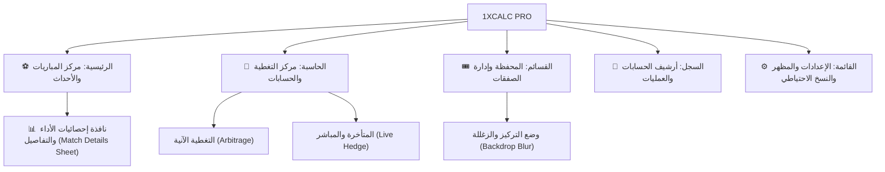

# ⚽ 1XCALC PRO | منصة وحاسبة الصفقات الرياضية ومتابعة المباريات المباشرة

تطبيق ويب تقدمي احترافي متكامل (**PWA Mobile-First**) مستوحى من واجهات وتجربة **1xBet** العالمية، يجمع بين **مركز متابعة المباريات والأحداث المباشرة لحظياً لجميع الدوريات الكبرى**، و**محرك الحساب الرياضي الذكي للصفقات** (التغطية الآنية والتغطية المتأخرة أثناء المباشر)، مع **محفظة متقدمة لإدارة قسائم الصفقات** ووضع التركيز والزغللة التفاعلي.

---

## 📱 التصميم العام وتجربة المستخدم (1xBet Aesthetic)

* **واجهة هاتف ذكية (Mobile-First):** شريط تنقل سفلي ثابت بخمسة أقسام رئيسية، مع زر عائم دائري في المنتصف لقسيمة الصفقات (**Betslip FAB**).
* **تنقل نقري دقيق ومباشر:** الانتقال التام بين التبويبات عبر النقر المباشر على أزرار شريط التنقل السفلي دون أي سحب عشوائي باللمس، لضمان استقرار الشاشة وسهولة التمرير العمودي وتصفح الجداول والمباريات دون قلق.
* **المظهر الفاتح والمظلم (Theme Switching):** الوضع الفاتح النشط افتراضياً عند أول تشغيل، مع إمكانية التبديل الفوري بنقرة واحدة للوضع المظلم الكحلي الرياضي الخاص بـ 1xBet، وحفظ الخيار تلقائياً في الذاكرة المحلية (`localStorage`).
* **شاشة بداية رياضية أنيقة (Splash Screen):** شاشة ترحيبية رياضية خاطفة تدوم لنحو 1.3 ثانية مع كرة قدم ترتد وتدور بفيزياء ثلاثية الأبعاد وظلال ديناميكية، متبوعة باسم المنصة الصريح وشريط تقدم انسيابي وتوقيع المطور `By: LHAJ-MATICH`، ثم تتلاشى بنعومة فائقة.
* **تطبيق ويب تقدمي (PWA):** قابل للتثبيت كأي تطبيق أصلي مع حزمة أيقونات محلية مخصصة (Favicon, Apple Touch Icon, WebP, Android Maskable Icons)، ويعمل بدون اتصال بكاش تلقائي محدث (`arb-calc-pwa-v14`).
* **الهوية البصرية وتناسق الألوان:** ألوان منسجمة بالكامل مع الشعار الجديد (الأخضر الزمردي الكهربائي، البنفسجي الحيوي، اللمسات الذهبية الدافئة، والكحلي الداكن الرياضي).

---

## 🗂️ الهيكلة وأقسام التطبيق الرئيسية



---

### 1️⃣ التبويب الأول: «الرئيسية» (مركز المباريات والبطولات العالمية - 1XBET Sports Hub)

شاشة رياضية تفاعلية عالمية تجلب جدول ونتائج وإحصائيات المباريات المباشرة لحظياً بالاعتماد على واجهات ESPN العامة دون الحاجة لمفاتيح:

* **مفتاح التبديل المزدوج لنوع المباريات (1xBet Dual Status Switcher):**
  * `🔥 مباشر (LIVE)`: حصر المباريات الجارية في هذه اللحظة (`state === 'in'`) مع دقيقة اللعب المباشرة وإطار أحمر نبضي وعداد ديناميكي في الوقت الفعلي.
  * `⏱️ المباريات القادمة والجدول (Pre-match)`: عرض المباريات المجدولة زمنياً التي لم تنطلق بعد.
  * `🌐 جميع المباريات (All)`: عرض شامل يجمع بين المباشر والقادم والمنتهي.
* **شريط التبديل بين الرياضات العالمية (Sports Switcher):**
  * ⚽ **كرة القدم (Soccer):** الدوريات والبطولات القارية الكبرى.
  * 🏀 **كرة السلة (NBA):** الدوري الأمريكي للمحترفين مع النتائج والإحصائيات الحية.
* **شريط الفلاتر السريعة بالأزرار الأفقية (Horizontal Time Chips):**
  * `الكل`: أهم وأقرب المباريات لليوم وأمس وغداً.
  * `خلال 6 ساعات`: حصر المباريات التي ستنطلق خلال الساعات الـ 6 القادمة.
  * `خلال 12 ساعة`، `خلال 24 ساعة`، `خلال 48 ساعة`.
  * `الأسبوع الحالي (كامل)`: من الاثنين حتى الأحد.
  * `الأسبوع القادم (كامل)`.
  * `نتائج سابقة`: نتائج المباريات المنتهية للأسبوع الماضي.
  * `تحديد الفترة ▾ (Select period)`: نافذة التقويم المخصص السفلية.
* **نافذة التقويم المخصص المنبثقة (Set Period Modal):**
  * نافذة سفلية منبثقة مطابقة لتصميم **1xBet** مع مقبض سحب علوي وتأثير بلور وزغللة للخلفية.
  * صندوقا تحديد البداية والنهاية (`Start` و `End`) مع شارات التاريخ والوقت.
  * تقويم شهري تفاعلي مع أسهم تنقل بين الأشهر وتظليل الأيام المحددة والمجال الزمني بين البداية والنهاية.
  * أزرار فترات سريعة جاهزة: `اليوم`، `غداً`، `نهاية الأسبوع`، `الـ 7 أيام القادمة`.
  * زرا `إلغاء (Cancel)` و `تطبيق (Apply)`.
* **شريط البطولات والدوريات مع عداد المباريات والنجوم المفضلة:**
  * شعارات رسمية وأعلام الدول مصنفة بدقة (دوري أبطال إفريقيا، كأس الكونفيدرالية، كأس الأمم الإفريقية، دوري أبطال آسيا للنخبة، دوري أبطال أوروبا، الدوري الأوروبي، دوري المؤتمر، دوري الأمم، كأس العالم، كأس العالم للأندية، الدوري الإنجليزي الممتاز والتشامبيونشيب، الإسباني والدرجة الثانية، الإيطالي، الألماني، الفرنسي، الاسكتلندي، دوري روشن السعودي، البرتغالي، الهولندي، التركي، الأمريكي، البرازيلي، الأرجنتيني، وNBA).
  * **عداد ديناميكي للمباريات (Dynamic Counter Badge):** يُظهر عدد المباريات المتاحة في كل دوري (مثلاً `(18)` أو `(2)`).
  * **نظام النجمة المفضلة (⭐ Favorites System):** تثبيت البطولات المفضلة في أعلى القائمة بنقرة واحدة على النجمة، وحفظها تلقائياً في التخزين المحلي (`localStorage`).
* **بطاقة المباراة الذكية (1xBet Match Card):**
  * شعارات الأندية بدقة عالية وأسماؤها الرسمية.
  * **عرض النتائج المنسجم 100% مع الاتجاه العربي (RTL):** الفريق المضيف على اليمين ورقمه بجانبه، والضيف على اليسار ورقمه بجانبه.
  * **تمييز الفريق الفائز:** إضاءة رقم الفائز باللون الأخضر الصريح (`digit-winner`) مع شارة خضراء بارزة `[فائز ✓]` لمنع أي التباس.
  * **الربط المباشر مع الحاسبة (⚡ حساب وتغطية الصفقة):** بنقرة واحدة يتم نسخ اسم المباراة والانتقال الفوري لتبويب الحاسبة وتعبئة حقول القسيمة تلقائياً.
* **نافذة تفاصيل وإحصائيات المباراة الشاملة (6 تبويبات عالمية 1xBet Style):**
  * **1. 📊 إحصائيات الأداء (Team Stats):** أشرطة مقارنة متقابلة ذات اتجاهين (الاستحواذ %، إجمالي التسديدات، التسديدات على المرمى، الركنيات، الأخطاء، البطاقات، التسلل، وتصديات الحارس).
  * **2. ⏱️ أبرز الأحداث (Key Events):** جدول زمني لأهداف اللقاء مع مسجليها والدقيقة الدقيقة، البطاقات، والتبديلات.
  * **3. 💬 التعليق المباشر (Live Commentary):** وصف نصي لحظي لمجريات اللقاء لقطة بلقطة مع توقيت كل كرة وهجمة.
  * **4. 👥 التشكيلة والخطط (Lineups & Formations):** خطط اللعب التكتيكية (مثل 4-3-3)، قائمة اللاعبين الأساسيين بأرقام قمصانهم ومراكزهم، دكة البدلاء، والمدير الفني لكل فريق.
  * **5. 🏆 جدول الترتيب الحي (Standings):** جدول الدوري المحدث لحظياً بنقاط الفرق وفارق الأهداف وعدد المباريات، مع تظليل وتمييز فريقي المباراة بلون أزرق بارز وشارة `[مباراة الآن]`.
  * **6. ℹ️ معلومات اللقاء (Match Info):** الملعب، المدينة، طاقم التحكيم، الحضور الجماهيري، والتوقيت الرسمي مع أزرار نسخ وتغطية.

---

### 2️⃣ التبويب الثاني: «الحاسبة» (مركز حساب الصفقات والتغطية)

يجمع التبويب الثاني كل أدوات الحساب في مكان واحد مع زرين علويين بنمط **1xBet** للتنقل الفوري:

#### أ. التغطية الآنية (Arbitrage / Dutching) - الزر الأزرق
* **المدخلات:** رأس المال الإجمالي، واحتمال الخيار الأول (الأزرق) واحتمال الخيار الثاني (الأخضر).
* **المخرجات اللحظية:** شريط حالة يحدد فوراً هل الصفقة رابحة أم خاسرة، مع بيان دقيق للمبلغ الواجب دخوله في كل خيار والعائد وصافي الربح.
* **حفظ القسيمة:** زر حفظ فوري لإرسال الصفقة مباشرة إلى محفظة القسائم.

#### ب. التغطية المتأخرة أثناء المباشر (In-Play Delayed Hedge) - الزر الأخضر
* **خيارات الدخول:**
  1. إدخال مبلغ الرهان 1 فقط لحساب المطلوب للرهان 2.
  2. تحديد رأس المال الإجمالي وتقسيمه بين الرهانين.
* **استهداف نسبة ربح محددة:** شرائح أرباح سريعة (0% تأمين، 5%، 10%، 15%، 20%، 25%، 30%، 50%) أو نسبة مخصصة.
* **المحاكي وفاحص الاحتمال الفعلي (Live O2 Simulator):** إدخال الاحتمال الذي وصل إليه السوق الآن في المباراة لمعرفة هل هو رابح أم خاسر، والمبلغ المطلوب، ومقارنته المباشرة مع هدفك، مع زر اعتماده فوراً كخطة حالية.
* **جدول الخطط السريع:** جدول تفاعلي لاختيار الاحتمال المناسب بضغطة واحدة.

---

### 3️⃣ التبويب الثالث: «القسائم» (المحفظة وإدارة الصفقات مع وضع التركيز)

* **الزر العائم البارز (Betslip FAB):** يقع في منتصف الشريط السفلي مع شارة عداد للصفقات الجارية.
* **لوحة إحصائيات المحفظة (Portfolio Hero):**
  * صافي الأرباح المحققة (**Realized P&L**).
  * إجمالي الأرباح وإجمالي الخسائر.
  * العائد على الاستثمار (**ROI%**) ونسبة النجاح (**Win Rate%**).
  * رأس المال النشط المستثمر في المباريات الجارية.
* **وضع التركيز والزغللة (Backdrop Blur & Focus Mode):**
  * عند النقر على أي قسيمة لتوسيعها، تبرز القسيمة بإطار أزرق ساطع وظلال ثلاثية الأبعاد وشارة `[جارية للتعديل 🛠️]`.
  * يتم تطبيق تأثير الزغللة والتعتيم (`blur(4px) opacity(0.32)`) على لوحة الأرباح العلوية وشريط البحث وكافة القسائم الأخرى لمنع التشتت والخلط.
  * زر سفلي صريح: `[إغلاق وطي تفاصيل القسيمة ✕]` يحدد نهاية بطاقة القسيمة بوضوح.
  * إمكانية طي القسيمة بمجرد النقر في أي مكان على الخلفية المزغللة.
* **خيارات إنهاء وحسم القسيمة الشاملة:**
  * اعتماد الرهان الثاني وإنهاء المباراة بربح مؤمّن.
  * فوز الرهان الأول فقط (دون تغطية).
  * خسارة الرهان الأول مبكراً.
  * تسوية كاش آوت يدوي (**Cashout**).
  * إعادة فتح القسيمة أو تعديل اسمها أو حذفها.

---

### 4️⃣ التبويب الرابع: «السجل» (الأرشيف والعمليات)

* سجل شامل لجميع العمليات الحسابية وقسائم الصفقات.
* فلترة سريعة: جميع العمليات، التغطية الآنية، أو المتأخرة والمحاكي.
* إمكانية استعادة بيانات أي عملية سابقة إلى الحاسبة بنقرة واحدة، أو مسح السجل.

---

### 5️⃣ التبويب الخامس: «القائمة» (لوحة التحكم والإعدادات)

* **تبديل المظهر:** كارت سريع بنقرة واحدة للتحويل بين الوضع الفاتح والوضع المظلم.
* **إعدادات الحساب:** تغيير رمز العملة (`$`، `USDT`، `MAD`، `€`، `SAR`)، الفواصل العشرية، ورأس المال الافتراضي.
* **النسخ الاحتياطي:** تصدير نسخة احتياطية مشفرة بصيغة `JSON` واستعادتها في أي وقت.
* **مسح البيانات:** تصفير السجلات أو القسائم بأمان مع رسائل تأكيد.
* **دليل الاستخدام والتثبيت:** شرح الاستراتيجيات وتثبيت التطبيق على أجهزة Android و iOS.

---

## 🛠️ التقنيات والبنية البرمجية المقسمة (Modular Architecture)

تمت إعادة هيكلة التطبيق بالكامل وتقسيمه من ملف أحادي ضخم إلى **معمارية معيارية حديثة (Modular Web Architecture)** متوافقة 100% مع استضافة **GitHub Pages** المجانية وكافة بيئات الاستضافة الثابتة:

```
1xcalc/
│
├── index.html                   # الهيكل الرئيسي النظيف للتطبيق (~1000 سطر)
├── manifest.json                # إعدادات تطبيق الويب التقدمي والشاشات
├── sw.js                        # عامل الخدمة والكاش التلقائي للعمل دون إنترنت (v17)
├── README.md                    # دليل الاستخدام والتوثيق البرمجي الشامل
│
├── css/                         # التنسيقات المقسمة معيارياً (Modular Stylesheets)
│   ├── variables.css            # متغيرات الألوان، الوضع الليلي والنهاري، والخطوط
│   ├── base.css                 # هيكل التطبيق، الهيدر، شريط التنقل، وشاشة البداية
│   ├── calculator.css           # أنماط الحاسبة (التغطية الآنية والمتأخرة والمحاكي)
│   ├── slips.css                # أنماط محفظة القسائم وبطاقات الصفقات ووضع التركيز
│   ├── matches.css              # مركز المباريات، شريط الرياضات، الفلاتر الزمنية، والبطولات
│   ├── modals.css               # النوافذ المنبثقة: إحصائيات المباراة (6 تبويبات) والتقويم المخصص
│   └── style.css                # ملف التنسيق المجمع (Master Stylesheet)
│
└── js/                          # الوحدات البرمجية المنفصلة (Modular JavaScript)
    ├── i18n.js                  # محرك التدويل وتجهيز اللغات المتعددة (عربي/إنجليزي/فرنسي)
    ├── storage.js               # إدارة الذاكرة المحلية، الإعدادات، والنسخ الاحتياطي
    ├── calculator.js            # خوارزميات حساب التغطية الآنية والمتأخرة والمحاكي
    ├── slips.js                 # إدارة قسائم الصفقات، حسم المباريات، وإحصائيات المحفظة
    ├── matches.js               # محرك جلب وفرز مباريات الدوريات والبطولات العالمية
    ├── match-details.js         # نافذة تفاصيل اللقاء وتبويباتها الـ 6 (الأداء، التعليق، التشكيلات...)
    ├── calendar.js              # نافذة تحديد الفترة الزمنية والتقويم الشهري التفاعلي
    └── app.js                   # نواة التطبيق، التنقل بين التبويبات، والمظهر، وتثبيت PWA
```

### 🚀 مميزات التقسيم والتوافق مع GitHub Pages:
1. **أداء تحميل فائق:** تحميل ملفات CSS و JS بالتوازي في المتصفح، مما يسرع وقت الاستجابة الأولية بنسبة تزيد عن 60%.
2. **توافق كامل مع GitHub Pages:** جميع المسارات والروابط نسبية (`./css/...` و `./js/...`) لتعمل دون أي مشاكل على النطاقات الفرعية (`username.github.io/repo/`).
3. **تطبيق ويب تقدمي أوفلاين (Offline PWA):** يقوم `sw.js` (الإصدار `arb-calc-pwa-v17`) بحفظ جميع الملفات المقسمة في الكاش المحلي، مما يضمن عمل التطبيق بكامل وظائفه بدون إنترنت.
4. **جاهزية اللغات المتعددة (i18n Ready):** وجود وحدة `i18n.js` يسمح بإضافة أي لغة جديدة مستقبلاً بسهولة تامة عبر تعديل قاموس الترجمة الموحد.

