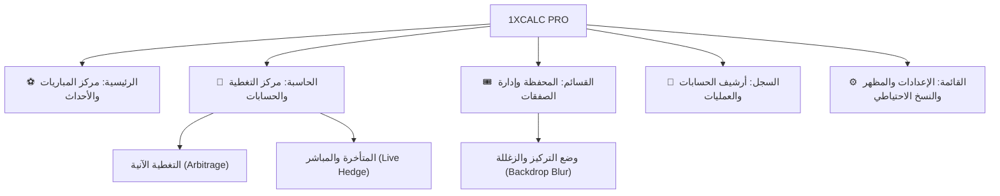

# ⚽ 1XCALC PRO | منصة وحاسبة الصفقات الرياضية ومتابعة المباريات المباشرة

تطبيق ويب تقدمي احترافي متكامل (**PWA Mobile-First**) مستوحى من واجهات وتجربة **1xBet** العالمية، يجمع بين **مركز متابعة المباريات والأحداث المباشرة لحظياً لجميع الدوريات الكبرى**، و**محرك الحساب الرياضي الذكي للصفقات** (التغطية الآنية والتغطية المتأخرة أثناء المباشر)، مع **محفظة متقدمة لإدارة قسائم الصفقات** ووضع التركيز والزغللة التفاعلي.

---

## 📱 التصميم العام وتجربة المستخدم (1xBet Aesthetic)

* **واجهة هاتف ذكية (Mobile-First):** شريط تنقل سفلي ثابت بخمسة أقسام رئيسية، مع زر عائم دائري في المنتصف لقسيمة الصفقات (**Betslip FAB**).
* **تنقل نقري دقيق ومباشر:** الانتقال التام بين التبويبات عبر النقر المباشر على أزرار شريط التنقل السفلي دون أي سحب عشوائي باللمس، لضمان استقرار الشاشة وسهولة التمرير العمودي وتصفح الجداول والمباريات دون قلق.
* **المظهر الفاتح والمظلم (Theme Switching):** الوضع الفاتح النشط افتراضياً عند أول تشغيل، مع إمكانية التبديل الفوري بنقرة واحدة للوضع المظلم الكحلي الرياضي الخاص بـ 1xBet، وحفظ الخيار تلقائياً في الذاكرة المحلية (`localStorage`).
* **تطبيق ويب تقدمي (PWA):** قابل للتثبيت كأي تطبيق أصلي، يعمل بدون اتصال، مع كاش تلقائي محدث (`arb-calc-pwa-v10`).

---

## 🗂️ الهيكلة وأقسام التطبيق الرئيسية

---

### 1️⃣ التبويب الأول: «الرئيسية» (مركز المباريات والأحداث المباشرة)

شاشة رياضية حية تجلب جدول ونتائج المباريات مباشرة بدون مفاتيح أو وسائط:

* **أولوية المباريات المباشرة (LIVE First):**
  المباريات الجارية الآن تظهر تلقائياً في قمة الشاشة بشريط نبضي أحمر مع توضيح دقيقة اللقاء والنتيجة الحية. في حال عدم وجود مباريات جارية، تُعرض أقرب المباريات المجدولة زمنياً.
* **شريط الفلاتر الزمنية السريعة:**
  * `🔥 مباشر الآن (LIVE)`: تصفية فورية للمباريات الجارية مع عداد حي.
  * `⭐ الأهم والأقرب`: أقرب المباريات اليوم وأمس وغداً.
  * `⚡ مباريات اليوم`.
  * `📅 الأسبوع الحالي (كامل)`.
  * `⏭️ الأسبوع القادم`.
  * `⏮️ النتائج المنتهية`.
  * منتقي تاريخ مخصص لاختيار أي يوم بعينه من التقويم.
* **شريط الدوريات العالمية الكبرى بالشعارات الرسمية وأعلام الدول:**
  * 🏆 **دوري أبطال أوروبا (UCL):** الشعار الرسمي الأزرق بنجوم الأبطال.
  * 🏴󠁧󠁢󠁥󠁮󠁧󠁿 **الدوري الإنجليزي الممتاز (Premier League):** شعار الأسد المتوج + علم إنجلترا الرسمي.
  * 🇪🇸 **الدوري الإسباني (LaLiga):** الشعار الرسمي الجديد للا ليغا + علم إسبانيا الرسمي.
  * 🇮🇹 **الدوري الإيطالي (Serie A):** الشعار الرسمي لسيريا A + علم إيطاليا الرسمي.
  * 🇩🇪 **الدوري الألماني (Bundesliga):** الشعار الرسمي للبوندسليغا + علم ألمانيا الرسمي.
  * 🇫🇷 **الدوري الفرنسي (Ligue 1):** الشعار الرسمي للدوري الفرنسي + علم فرنسا الرسمي.
  * 🌍 **الدوري الأوروبي (Europa League):** الشعار البرتقالي الرسمي لليوروبا ليغ.
  * 🇸🇦 **دوري روشن السعودي:** الشعار الرسمي لدوري روشن + علم السعودية الرسمي.
  * ⭐ خيار "كل الدوريات الكبرى" معاً.
* **بطاقة المباراة الذكية (1xBet Match Card):**
  * شعارات الأندية بدقة عالية وأسماؤها الرسمية.
  * **عرض النتائج المنسجم 100% مع الاتجاه العربي (RTL):** الفريق المضيف على اليمين ورقمه بجانبه، والضيف على اليسار ورقمه بجانبه.
  * **تمييز الفريق الفائز:** إضاءة رقم الفائز باللون الأخضر الصريح (`digit-winner`) مع شارة خضراء بارزة `[فائز ✓]` لمنع أي التباس في النتائج.
  * **الربط المباشر مع الحاسبة (⚡ حساب وتغطية الصفقة):** بنقرة واحدة يتم نسخ اسم المباراة والانتقال الفوري لتبويب الحاسبة وتعبئة حقول القسيمة تلقائياً دون الحاجة لكتابة الاسم يدوياً.

---

### 2️⃣ التبويب الثاني: «الحاسبة» (مركز حساب الصفقات والتغطية)

يجمع التبويب الثاني كل أدوات الحساب في مكان واحد مع زرين علويين بنمط **1xBet** للتنقل الفوري:

#### أ. التغطية الآنية (Arbitrage / Dutching) - الزر الأزرق
* **المدخلات:** رأس المال الإجمالي، واحتمال الخيار الأول (الأزرق) واحتمال الخيار الثاني (الأخضر).
* **المخرجات اللحظية:** شريط حالة يحدد فوراً هل الصفقة رابحة أم خاسرة، مع بيان دقيق للمبلغ الواجب دخوله في كل خيار والعائد وصافي الربح.
* **حفظ القسيمة:** زر حفظ فوري لإرسال الصفقة مباشرة إلى محفظة القسائم.

#### ب. التغطية المتأخرة أثناء المباشر (In-Play Delayed Hedge) - الزر الأخضر
* **خيارات الدخول:**
  1. إدخال مبلغ الرهان 1 فقط لحساب المطلوب للرهان 2.
  2. تحديد رأس المال الإجمالي وتقسيمه بين الرهانين.
* **استهداف نسبة ربح محددة:** شرائح أرباح سريعة (0% تأمين، 5%، 10%، 15%، 20%، 25%، 30%، 50%) أو نسبة مخصصة.
* **المحاكي وفاحص الاحتمال الفعلي (Live O2 Simulator):** إدخال الاحتمال الذي وصل إليه السوق الآن في المباراة لمعرفة هل هو رابح أم خاسر، والمبلغ المطلوب، ومقارنته المباشرة مع هدفك، مع زر اعتماده فوراً كخطة حالية.
* **جدول الخطط السريع:** جدول تفاعلي لاختيار الاحتمال المناسب بضغطة واحدة.

---

### 3️⃣ التبويب الثالث: «القسائم» (المحفظة وإدارة الصفقات مع وضع التركيز)

* **الزر العائم البارز (Betslip FAB):** يقع في منتصف الشريط السفلي مع شارة عداد للصفقات الجارية.
* **لوحة إحصائيات المحفظة (Portfolio Hero):**
  * صافي الأرباح المحققة (**Realized P&L**).
  * إجمالي الأرباح وإجمالي الخسائر.
  * العائد على الاستثمار (**ROI%**) ونسبة النجاح (**Win Rate%**).
  * رأس المال النشط المستثمر في المباريات الجارية.
* **وضع التركيز والزغللة (Backdrop Blur & Focus Mode):**
  * عند النقر على أي قسيمة لتوسيعها، تبرز القسيمة بإطار أزرق ساطع وظلال ثلاثية الأبعاد وشارة `[جارية للتعديل 🛠️]`.
  * يتم تطبيق تأثير الزغللة والتعتيم (`blur(4px) opacity(0.32)`) على لوحة الأرباح العلوية وشريط البحث وكافة القسائم الأخرى لمنع التشتت والخلط.
  * زر سفلي صريح: `[إغلاق وطي تفاصيل القسيمة ✕]` يحدد نهاية بطاقة القسيمة بوضوح.
  * إمكانية طي القسيمة بمجرد النقر في أي مكان على الخلفية المزغللة.
* **خيارات إنهاء وحسم القسيمة الشاملة:**
  * اعتماد الرهان الثاني وإنهاء المباراة بربح مؤمّن.
  * فوز الرهان الأول فقط (دون تغطية).
  * خسارة الرهان الأول مبكراً.
  * تسوية كاش آوت يدوي (**Cashout**).
  * إعادة فتح القسيمة أو تعديل اسمها أو حذفها.

---

### 4️⃣ التبويب الرابع: «السجل» (الأرشيف والعمليات)

* سجل شامل لجميع العمليات الحسابية وقسائم الصفقات.
* فلترة سريعة: جميع العمليات، التغطية الآنية، أو المتأخرة والمحاكي.
* إمكانية استعادة بيانات أي عملية سابقة إلى الحاسبة بنقرة واحدة، أو مسح السجل.

---

### 5️⃣ التبويب الخامس: «القائمة» (لوحة التحكم والإعدادات)

* **تبديل المظهر:** كارت سريع بنقرة واحدة للتحويل بين الوضع الفاتح والوضع المظلم.
* **إعدادات الحساب:** تغيير رمز العملة (`$`، `USDT`، `MAD`، `€`، `SAR`)، الفواصل العشرية، ورأس المال الافتراضي.
* **النسخ الاحتياطي:** تصدير نسخة احتياطية مشفرة بصيغة `JSON` واستعادتها في أي وقت.
* **مسح البيانات:** تصفير السجلات أو القسائم بأمان مع رسائل تأكيد.
* **دليل الاستخدام والتثبيت:** شرح الاستراتيجيات وتثبيت التطبيق على أجهزة Android و iOS.

---

## 🛠️ التقنيات المستخدمة

* **الواجهة:** HTML5, CSS3 الحديث مع CSS Custom Properties للتخصيص الكامل للثيمات.
* **الأيقونات والشعارات:** Font Awesome 6.5.1 + شعارات الدوريات الرسمية بدقة عالية من ESPN CDN + أعلام الدول من FlagCDN.
* **جلب البيانات:** Fetch API للتواصل اللحظي مع سيرفرات الـ Scoreboard الرياضية العالمية.
* **التخزين المؤقت:** الذاكرة المحلية `localStorage` + ذاكرة Map الذكية للحد من استهلاك البيانات.
* **PWA:** Web App Manifest + Service Worker للتثبيت السريع والعمل دون إنترنت.
